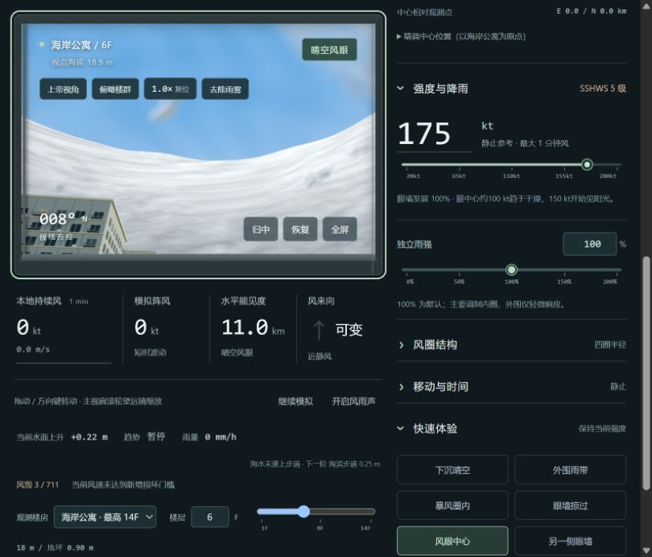

# TClangfall Emulator · 临海台风视场模拟器

[](https://github.com/Nekobenzene/TClangfall-Emulator/actions/workflows/pages.yml)
[](LICENSE)

以临海住宅与自由飞行视角观察台风的交互式 Three.js 模拟器。调整台风位置、强度、风圈结构、雨强与移动，观察风雨、能见度、螺旋眼墙、景物风毁及简化风暴潮的变化。所有运行资源内嵌，支持单文件离线使用。

**[在线体验](https://nekobenzene.github.io/TClangfall-Emulator/)** · [下载离线 HTML](https://github.com/Nekobenzene/TClangfall-Emulator/raw/refs/heads/main/%E5%8F%B0%E9%A3%8E%E6%A8%A1%E6%8B%9F%E5%99%A8.html) · [项目源码](https://github.com/Nekobenzene/TClangfall-Emulator)



## 快速开始

打开 **台风模拟器.html** 即可使用。Three.js、贴图、地图、建筑和天气均已内嵌，无需联网或安装。

## 风场与天气

- 输入为静止参考的最大一分钟持续风，20–200 kt。
- 低于 67 kt 不设眼和眼墙，但中心风速仍降低；低于 34 kt 不设暴风圈。从 67–110 kt，眼墙增强与风眼风速减弱由零平滑发展到完整结构，最大风速半径也连续收缩；地图眼和眼墙线条同步淡入。无效结构的参数暂存，增强后恢复。四个可调半径：风眼、核心眼墙外界、暴风圈、外围影响圈，自动保持从内到外的次序。暴风圈为自定义结构边界，不是固定风速的等值线。
- 风眼至眼墙内侧维持宽缓过渡；最大风速半径至眼墙外界陡降；眼墙外界至暴风圈的持续风较弱，向内缓慢增强，持续降雨且阵风波动较小。成熟台风暴风圈内雨量大致均匀、向内略增，至眼墙外侧陡增后维持到眼区边缘；无眼系统使用更强的向内增雨梯度。
- 外围影响圈向暴风圈靠近，持续风逐步增强，阵风的相对波动逐步减小。外围阵风和阵雨大体相关，但具有不同的到达时间和独立脉冲。极大外围暴雨较罕见，但可以强于眼墙，表现为大量密集长雨丝及极低能见度；阵雨间隙偶有多云和晴空。
- 外围影响圈之外为下沉晴空，仍有较弱、可变化的风和阵风，不会突然变成完全静风。阵风事件概率在边界内外连续；阵雨概率从圈内平滑降至边界的零，匹配圈外晴空。向内阵风阵雨出现概率增加，相对波动幅度依然减小。
- 北半球逆时针环流，向心流入 15°，把移速的 65% 作为向量叠加。前进去向右侧为危险半圆、左侧为相对较弱的安全半圆，本地风速可能超过静止参考输入。
- 弱系统中心保留雨；67–100 kt 眼内雨量连续减少，约 100 kt 眼中心趋于无雨；150 kt 左右开始见阳光，至 180 kt 逐渐成为明亮晴空，190 kt 起眼内低中云清空。90–130 kt 雨丝逐渐转为碎雾，130 kt 左右近乎横行，100 kt 后树干弯曲显著增大。
- 独立雨强为 0–200%，主要调制暴风圈内降雨，仅轻微调制外围。强风雨下天空纹理淡去，与雨雾颜色融合。
- 轻碎屑、中等杂物、大板片有不同起飞阈值、风速跟随率、惯性、翻滚速度和飞行高度：轻碎屑更高、更快，大板片需要更强风才抬升，运动较慢且更低。

## 场景与简化增水

默认观测点为临海公寓六层，距地坪 18 m、海拔 18.9 m，距常态海岸约 40 m。可在地图点选五座楼房，或从主视窗下方切换楼房和楼层；各楼支持的最高楼层不同，最高 40 层。风雨随观测点移动。增加多座 29–125 m 高的住宅，视场角扩大到 58°，方位可调 -75° 至 95°，俯仰 -40° 至 38°。默认视野仍以住宅和海面各占一侧。

简化增水随本地持续风增强，170 kt 对应约 3 m（约一层楼高度；实际淹深需扣除地坪海拔），200 kt 约 4.3 m，硬上限 4.5 m。上升时间常数为 40–65 模拟分钟。高水位保留穿过风眼；170 kt、30 kt 移速情形中，中心离开至少 500 km 后才开始回落，之后按峰值水位约 6 模拟小时的速度缓慢退去。时间倍率同时影响涨水与退水。主界面及全屏显示相对常态水位的当前上升米数（精确至 0.01 m）、涨退趋势与速率。海岸设有固定海拔阶梯：步道 0.25 m、道路 0.55 m、住宅前场 0.90 m、内街 1.70 m、高处住宅台地 2.90 m、内陆高地 4.65 m，短坡和楼梯连接。海水只升降，地形高于水面时保持露出，水位超过后依次淹入；建筑与观测高度计入地台海拔。浅水区可透出淹没的台阶和路面标线，较深水区逐渐变浑；界面显示已漫过的台阶与下一阶门槛。白色细带移动表现海面浪带，白斑表现雨水击打；不计算波浪起伏、破碎、真实海岸水动力或结构力学。增水数值仅用于视觉演示，不是风暴潮预报。

新增风响应景观：旗布、电线、草木、垃圾桶盖。环境杂物总体减少约 30%，海上来风时进一步降至陆上来风约 22%。风毁按每个物体本地风速和累计受风时间计算，树木、路灯、窗户的门槛分别为 145、155、160 kt；超过门槛后风速越大，坚持时间越短，各物体耐受力略有差异。包含树折/拔根、桶和路牌翻倒飞走、窗户碎裂、路灯折毁、护栏变形及旗布脱落。此为简化视觉效果。点“恢复”清除累计损伤、修复景物，保留台风和水位；“重置”复位全部。

全屏下通过“观测显示”独立开关风速风向、雨量、当前水面上升和小地图。风速可切换持续风/阵风，地图可切换持续风场着色，并支持拖动与缩放。

地图按公里比例表示风场，住宅区按实际约 1.8 km 的尺度绘制；楼房定位符号为便于识别而放大，不代表建筑的真实占地。

## 手机与平板

支持横竖屏与安全区布局，主视窗单指拖动环视、双指捏合缩放。“视角”展开临时操作面板，含上帝视角、俯瞰、缩放、去雾、归中和恢复；点选后收起。进入上帝视角后，左下角半透明摇杆控制水平飞行，右下角“升 / 降”改变高度；可同时环视和移动。松手、切换视角、旋转屏幕或离开页面会停止触屏移动。横屏时摇杆与升降键贴两侧，操作条居中贴底。

三种地图均可单指平移、双指缩放；开启“移动风暴中心”后才允许单指设置中心，双指缩放不会触发风暴定位。全屏读数压缩为顶部窄条，可用“读数”隐藏；小地图默认收起，点“地图”展开，此时暂时隐藏飞行控件以免遮挡和误触。“视角 → 显示选项”保留各读数、小地图和持续风 / 阵风选择。“净览”隐藏所有覆盖层，只留“显示”按钮恢复。触屏设备不会请求鼠标锁定。不支持原生全屏的浏览器自动使用页面全屏。手机端降低渲染像素比和阴影贴图尺寸以减轻负载，天气计算保持一致。

## 操作

画面工具栏的“去除雨雾”只降低整体雾遮蔽，保留雨丝、碎雾与运动白色雾带；显示的气象能见度和风雨计算不变。滚轮最广为 0.35 倍（垂直视场约 115°），最窄为 12 倍（约 5.3°），广角端有轻微桶形镜头畸变和边缘暗角。

全屏时在场景上移动鼠标即可环视，无需按住；移动到工具栏、地图、菜单时暂停环视，便于操作。全屏小地图新增“拖动风暴中心”开关，与普通地图及大地图的开关同步；关闭后恢复地图平移。

晴空和低降水时采用较强的太阳直射、蓝天漫射与地面反弹光，建筑、树和棚屋有真实投影。阴雨时光线转冷、对比减弱。海面加入视角相关的天空反射、掠射角水色过渡与太阳碎光；细纹理随距离淡出以减少远处闪烁，仍不计算波浪起伏或破碎。

主视窗滚轮在 **0.35–12 倍**间缩放，采用真实透视视场角转换；点击倍率恢复 1 倍。高倍率下拖动灵敏度降低，便于看远处景物。

“上帝视角”从当前楼层视点进入无碰撞自由飞行：点击视窗后 **WASD** 前后左右，WASD 取视线的水平方向，俯仰不改变高度；**Q / E**（或 C / 空格）垂直下降 / 上升，**Shift** 四倍加速。可在全空间移动，包括穿过建筑或地面；拖动 360° 环视，俯仰 ±89°。下方速度滑块为 1–300 m/s，带标度。飞行不受天气暂停和时间倍率限制。实际相机位置参与风雨采样，地图显示自由视点及缩放后的视场扇形。“俯瞰楼群”直接到海岸上空；“返回楼房”或重新选楼回到原楼层，“归中”把自由视点移回所选楼房。

新增 31 座建筑、更多车辆 / 长椅 / 花池，总计 59 棵不同高度的棕榈、阔叶、针叶、窄冠树，全部保留随风弯曲与断裂 / 拔根。海边五座轻型棚屋在本地风超过 120 kt 后按暴露时间受损，墙板倾倒、屋顶掀起并飞走；恢复按钮重建。中低风速雨丝下落从约 19 增至 32 m/s（约 +68%），粒子上限从 9000 增至 22000，并提高低雨量下的可见密度和不透明度；90–130 kt 仍逐渐转为横行碎雾。

“风场色标”在小地图下方、大地图工具栏与全屏小地图中均可打开。预设包括海岸默认、经典气象彩虹、Viridis、Inferno、灰阶与风级分段。可编辑 0–300 kt 的风速节点、颜色拾取器与 HEX，增删节点并切换连续 RGB / 分段色阶；同速双节点可形成跳变。三种地图及其图例共用同一映射，范围外延续端点颜色，不改变实际风场。当前色标自动保留，可保存到“我的色标”，或通过 JSON 文本导入导出；风速色标使用 `unit: "kt"` 和 `nodes: [{value, color}]`，不直接套用红外温度节点。

所有滑动条均有数值标度，楼层和风圈半径的标度随有效范围更新。时间倍率为 1–1000 对数滑块，1、10、100、1000 倍等距；数字框保持实际倍数，方向键按 1 倍微调，Home / End 到两端。

风暴潮漫过步道与道路后，积水中会出现瓶罐、木板和箱体。小件漂得更快、大件漂得更慢且转向更迟缓；漂流速度随风速增强，并受浅水限制。漂浮物会绕阻楼房，在水深不足或退水时搁浅；“恢复”和“重置”会复位漂浮物。正北方增加三层低多边形远山，随场景雾效与能见度自然显隐。

1. 地图默认拖动平移，点击楼房选择观测点；只有开启“移动风暴中心”才可点击或拖动设中心。滚轮缩放，地图宽度 0.24–3200 km，也可用滑条调节。放大地图可查看实时持续风速热力图和风矢量；风场仅有轻微平滑不对称，越强的核心越对称。
2. 台风强度、四个半径、中心东西/南北距离、移动方向/速度、时间倍率、视线方位和俯仰均支持滑条。独立雨强可单独调节。中心数值控制在“精调中心位置”内，以海岸公寓为固定原点；地图读数相对所选楼房。数值框按 Enter 或移开焦点提交。
3. 拖动方向转盘调整移动去向；转盘聚焦时方向键微调，Shift 为每次 15°。0° 北、90° 东、180° 南、270° 西。转盘、数字框和滑条同步。
4. 点击“开始推进中心”自动移动，时间倍率 1–1000 倍（对数滑块，标注 1/10/100/1000×），同时影响时钟、阵风阵雨切换、风暴潮涨退及累计受风损伤，即使中心固定也生效。移速为 0 时首次启动设为 15 kt。暂停推进保留移速对风场的贡献；全局暂停冻结天气、增水与中心移动。
5. 拖动主视窗、方向键或下方滑条观察。六个快速体验按钮保持当前强度和结构参数，停止中心推进；“归中”只复位视角。
6. 地图的“楼群”放大至五座楼房，“观测点”移回当前楼房，“全风场”显示完整外围圈。地图聚焦后方向键默认平移，开启移动风暴后才移动中心，Shift 加速。

桌面端控制区滚动时主视窗保持可见；手机端纵向排列。风雨声默认关闭。

## 源码和验证

需要 Node.js 22 或更新版本；无需安装 npm 依赖。修改 `src/` 中的源码后运行：

```powershell
node build.mjs
node --test tests/*.test.cjs
```

开发预览：`node serve.cjs`，访问 `http://127.0.0.1:8787`。最终 HTML 不依赖服务器。

### 静态托管

`node build.mjs --pages` 会额外生成 `_site/index.html`，可直接部署到任意静态网页托管服务。GitHub Pages 通过 [Pages 工作流](.github/workflows/pages.yml) 在每次推送到 `main` 时自动构建、运行全部测试并部署；也可以在 Actions 中手动运行。仓库 Settings → Pages 的发布来源应设为 **GitHub Actions**。

### 目录

| 路径 | 内容 |
| --- | --- |
| `src/model.js` | 风场、降雨、阵风、增水与风毁参数 |
| `src/app.js` | 场景、天气粒子、交互与主循环 |
| `src/eye-wall.js` | 实际尺度眼墙、螺旋纹理与眼内分层云 |
| `src/camera.js`、`src/view-effects.js` | 相机运动、镜头与光照 |
| `src/map.js`、`src/wind-colors.js` | 地图、风场与自定义色标 |
| `src/scenery.js`、`src/flood-debris.js` | 风响应景物、风毁与漂浮物 |
| `tests/` | 模型、渲染结构、操作逻辑与打包检查 |
| `台风模拟器.html` | 构建后的单文件离线版本 |

## 许可证

项目原创代码采用 [MIT License](LICENSE)。内嵌 Three.js r160 保留其独立的 [MIT 许可证](THREE-LICENSE.txt)，最终 HTML 亦附完整第三方许可证。参考项目与素材来源见下文；程序生成场景不包含外部照片或付费模型。

模型测试覆盖眼墙形成、眼区减雨和日照随强度连续变化、成熟暴风圈均匀雨量及眼墙雨量平台、无眼系统雨强梯度、170 kt 对应 3 m 与增水减速、34/67 kt 结构阈值、中心减风与保留雨、边界概率连续、独立雨强调制、持续风场一致性与强度对称性、罕见外围极大暴雨、四个半径的边界次序与连续性、内侧平缓/眼墙陡峭/暴风圈缓增、移动半圆、晴空外围弱阵风、稳定暴风圈天气、外围风雨部分错峰、极大阵雨与晴空间歇、不同体量杂物、增水函数及原有强风视觉阈值。地形测试覆盖台阶海拔、依次漫淹、高地保持干燥、岸线与地形相交及海水连通性。演化测试覆盖 170 kt / 30 kt 离开 500 km 前保水、之后缓退、涨退随时间倍率一致、风毁门槛与累积损伤及海风杂物减少。打包检查覆盖内嵌脚本语法、离线资源和许可证。

这是简化视觉模型，非气象预报或工程模型。世界坐标东 +x、北 -z，地图北朝上，1 kt = 1852/3600 m/s。雨量和能见度用于驱动画面，本地持续风为参考平均值，“模拟阵风”和风来向反映瞬时气流，粒子使用同一瞬时风向量。

## 开源来源

风场色标编辑参考 [IR-enhancer](https://github.com/Nekobenzene/IR-enhancer) 的“数值节点、连续 RGB 插值、统一图例映射和 JSON 色标”设计；代码独立实现，色标改为风速单位，并保持最终单文件离线使用。预设风速色标内嵌于 `src/wind-colors.js`，滑动条映射与标度在 `src/sliders.js`。

渲染使用 [Three.js r160](https://github.com/mrdoob/three.js/tree/r160)，MIT 许可证见 `THREE-LICENSE.txt` 和最终 HTML 尾部。参考 [官方动态粒子示例](https://threejs.org/examples/webgl_points_dynamic.html)，源文件在 `references/`。此前查阅 [Kenney City Kit (Suburban)](https://kenney.nl/assets/city-kit-suburban)（CC0）；最终建筑和天气由程序几何生成，未打包其模型。

全屏下按 **M** 切换鼠标锁定与控件操作；使用相对鼠标位移，横向视角可连续绕转，不受屏幕边缘限制。画面不显示中心十字。
不支持原生鼠标锁定的内置浏览器自动使用边缘持续转向，M 同样可开启或关闭。

## 风眼云墙与移动雨幕

风眼中心约 100 kt 雨停时云墙便已形成，初期受厚云、平淡光照和散射遮挡，云隙及能见度改善后才逐渐显露；较强系统云顶更高、内壁更完整，保留暗底、亮顶和向外倾斜的体育场形结构。风眼内缘、眼墙外缘均直接使用设置中的公里数据，固定在风暴中心，随风暴平移；自由飞行也可接近或穿越云墙。云顶约 11.5–17 km，为可视化设定。大风眼开口更宽、墙顶仰角更低，边缘观察时近侧更高、更近。远景使用对数深度并依照能见度添加空中透视。参考 [NOAA/AOML 多里安风眼实拍](https://www.aoml.noaa.gov/eye-of-dorian-during-intensification/)，照片仅作形态参考，全部云体由程序生成。

雨丝与运动雾带使用空气位移减去相机位移，包含 WASD 水平飞行及 Q/E 升降；雨线方向和长度也按相对速度变化。相机移动不受天气暂停影响；天气暂停后，移动视角仍会穿越世界中静止的粒子。粒子循环支持单帧跨越多个范围，切换楼房或瞬间跳转视角会重新定位粒子范围。

新增验证：`node --test tests/*.test.cjs`，包含实际尺度、开口仰角、太阳遮挡、风暴平移与相机相对粒子运动，共 12 组。

云墙内壁严格限制在风眼内可见，眼墙和暴风圈使用连续低云顶，圈外沿用原天空。内壁为连续螺旋纹理，按最大风速处的角速度（Vmax/RMW）随模拟时间逆时针旋转，时间倍率与暂停均生效，修改参数不会跳相位。眼内约 0.75–1.5 km 低云和 2.7–3.8 km 中云采用同一程序密度场控制天空云隙和内壁遮挡，强度越高越稀薄，190 kt 起完全清空。强风雨时天空与场景雾色在相同输出颜色空间融合，兼容普通视角和广角后处理。

浏览器触屏回归检查（需本地 Playwright 与 Edge）：`node tests/mobile-layout.browser.cjs`，覆盖普通与全屏、横竖屏、摇杆触控、读数与地图、净览及视角面板。
